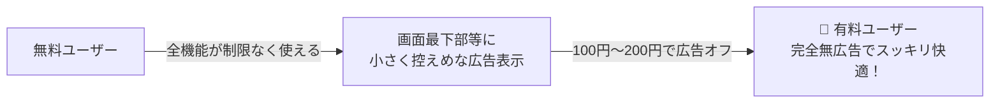

# アプリ収益化・セキュリティ・データ管理 ロードマップ

作成した5つのWeb/デスクトップアプリ（`schedule-app` / `Chronos`, `device-controller-app`, `SubMonitorManager`, `password-manager-app`, `micro-chat`）を安心して収益化するためのガイドラインです。

---

## 1. 「Microsoft Store 丸投げ」の評価

### 💡 結論：方向性として大正解です！
Microsoft Store を利用すると、個人開発者が最も苦労する以下のポイントを **Microsoft が代行** してくれます。

* **決済代行**: クレジットカード決済、領収書発行、返金対応など
* **配信・更新代行**: ユーザーのパソコンへの安全なインストール、最新版への自動アップデート
* **信頼性**: Microsoftの審査を通過したアプリとしてユーザーが安心して購入できる

---

## 2. 懸念点3つに対する具体的処方箋

### ① ネット環境によるデータ保存不具合（通信切れ対策）
* **問題**: ネットが不安定な場所で操作するとデータが消えたり保存に失敗する。
* **処方箋（オフライン同期）**:
  * Firebaseの **「オフライン耐久機能（Offline Persistence）」** を有効化します。
  * ネットが切れていても一旦端末内（ブラウザ）に安全に保存され、**ネットが復帰した瞬間に自動的にクラウドに同期**されます。

### ② セキュリティ（個人情報・情報漏洩対策）
* **問題**: 他人のデータが見えたり、重要情報が漏洩するリスク。
* **処方箋**:
  * **Firebase セキュリティルール**: 「自分のデータは自分しか読めない・書けない」設定を標準化。
  * **端末側暗号化 (End-to-End Encryption)**: `password-manager-app` 等の極秘データは送信前に暗号化。

### ③ データ保存容量の拡大とコスト（スケール対策）
* **問題**: ユーザーが増えたら容量が足りなくなるか？ サーバー代が跳ね上がるか？
* **処方箋**:
  * 5つのアプリが扱うデータは主に「テキスト（文字・日時・設定値）」です。非常に軽量なため、**Firebaseの無料枠（1GB保存・1日5万回アクセス無料）だけで相当数のユーザーまで完全無料で運用可能**です。

---

## 3. 🛒 Microsoft Store 登録・販売開始の具体的手順

Microsoft Store でアプリを登録・有料販売するまでのステップです。

### ① 事前準備：開発者アカウントの作成
* **登録場所**: [Microsoft Partner Center (パートナーセンター)](https://partner.microsoft.com/dashboard)
* **登録費用**: **初回のみ 約$19 USD（約2,800円）** （年会費0円・1度払えば一生使い放題）

### ② 提出用パッケージファイルの準備
* **Webアプリ（`Chronos`, `micro-chat` 等）の場合**:
  * Microsoft公式の無料ツール **[PWABuilder](https://www.pwabuilder.com/)** を使用。URLを入力するだけで1分で提出用ファイル（.msixbundle）が自動作成されます。

### ③ パートナーセンターでの登録・設定
1. **アプリ名の予約**
2. **価格と配信（有料・買い切り・アプリ内購入の設定）**
3. **ストア掲載情報（商品説明・スクショ）**
4. **年齢制限アンケート（自動判定）**
5. **パッケージのアップロード**

### ④ 審査 ＆ 自動公開（販売開始）
* 通常 **1日〜3日程度** でMicrosoftによる審査が完了し、公開されます。

### ⑤ 売上金のお支払い（入金）
* **Microsoftの手数料**: わずか **12%〜15%** （売上の 85%〜88% が開発者の利益）。登録口座へ月単位で自動振込。

---

## 4. 📢 広告 ＆ フル機能開放モデル（おすすめ運用方針）

### 🌟 「全機能フル開放 ＋ 控えめな広告 ➔ 有料(100〜200円)で広告非表示 (Ad-Free)」モデル

せっかく作ったアプリだからこそ**「機能を制限せず、全員にフル機能で使ってほしい！」**という想いと、収益化を両立させる**最高の王道モデル**です（YouTube Premium や Spotify、人気アプリと同じ仕組み）。

#### このモデルの4つの強み
1. **全員がフル機能を使える**: 機能制限がないため、無料ユーザーもアプリの魅力を100%体験して大ファンになってくれる。
2. **誤タップを狙わない親切な設計**: イライラさせる巨大広告ではなく、画面最下部やサイドバーに「小さく控えめに」配置。デザインを崩さない。
3. **「広告を消したい」という明確な有料価値**: 100円〜200円で広告が消えて完全スッキリ使えるため、ユーザーも納得して購入しやすい。
4. **二重の収益源**: 無料ユーザーの広告表示・クリック収入 ＋ 有料ユーザーの100円〜200円購入収入の両方が得られる。

---

### 各アプリでのスマートな広告配置と「広告消去 (Ad-Free)」プラン

| アプリ名 | 🎁 無料時の使い心地 | 広告のスマートな配置場所 | 💎 100円〜200円で得られる効果 |
| :--- | :--- | :--- | :--- |
| 📅 **`Chronos`** (カレンダー＆メモ) | **全機能フル開放** | 画面一番下のフッター領域に小さな横長バナー | **完全無広告化 (Ad-Free)** |
| 💬 **`micro-chat`** (デスクチャット) | **全機能フル開放** | サイドバーの最下部に小さなバナー枠 | **完全無広告化 (Ad-Free)** |
| 🔑 **`password-manager-app`** (パスワード管理) | **全機能フル開放** | 設定画面やウィンドウ最下部の細い帯枠 | **完全無広告化 (Ad-Free)** |
| 🖥️ **`SubMonitorManager`** (画面分割) | **全機能フル開放** | 設定パネルの最下部 | **完全無広告化 (Ad-Free)** |
| 🕹️ **`device-controller-app`** (周辺機器管理) | **全機能フル開放** | メイン画面の最下部 | **完全無広告化 (Ad-Free)** |
